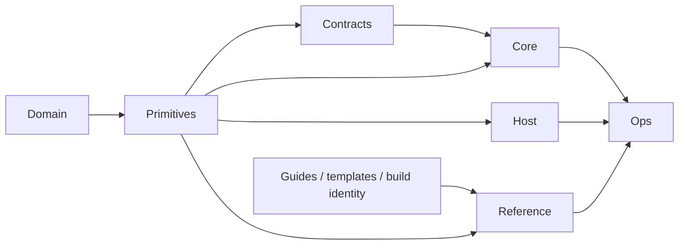

# Incremental development builds

## Commands

Cargo remains supported on the pinned Rust toolchain. Select the affected scope
while editing; the default runner still executes the complete candidate scope.

```bash
python3 tests/run.py --suite native --rust-package loom-host
python3 tests/run.py --suite native --rust-package loom-core --rust-filter recovery
python3 tests/run.py --suite packaging --python-pattern test_build_inputs.py
python3 dashboard/workspace/build.py --check
```

Selected runs record `complete=false`; omitted tests are not passes. Rust reports
identify the Cargo target and fully qualified test name. A suite/file is the Python
selection unit. The full runner and feature audit remain release acceptance tools.

The native Bazel graph uses the same Cargo manifests/lock and pinned Rust toolchain.
For deployment-compatible native artifacts, use its fixed Linux x86_64 Bookworm
build platform:

```bash
python3 deploy/bazel.py test //tests:developer //dashboard:workspace
python3 deploy/bazel.py test //tests:release //dashboard:workspace
```

The wrapper requires existing Docker access. It downloads the checksum-pinned
Bazel executable into `target/build-cache/bookworm/tools`, uses the digest-pinned
builder from `build_support/platform.json`, mounts source read-only, and writes
only to its selected cache. It does not mount the Docker socket, host home,
installation data or credentials. A platform change requires a new cache directory.
Use `--cache PATH` before the Bazel command to select another output root.

`developer` covers native rules and actual HTTP/MCP with the pinned client. The
100k file-index correctness case and the 5,001-item concurrent catalog/read fixture
run separately in `release`; neither dataset nor the mutation-latency assertion
is reduced. The large HTTP fixture runs exclusively within that Bazel invocation.
These targets cover the native graph, not the retained Python compatibility suites.
Run `python3 tests/run.py --browser` for complete retained/native/browser coverage.
No deployment or installation follows any build/test target.

The wrapper exports only native executables in the selected Bazel dependency
closure, under `target/build-cache/bookworm/native`. Its `platform.json` records
platform and binary digests, not operational acceptance. Generated HTML is exported
to `target/build-cache/bookworm/web/workspace.html` when built. Local acceptance
always executes again:

```bash
python3 tests/build/native_image.py \
  target/build-cache/bookworm/native/loom-ops \
  target/build-cache/bookworm/native/loom-sdk
```

This creates/removes a private image/container, binds loopback only, and runs one
CPU producer on disposable storage. Firefox acceptance uses explicit candidate
binaries/HTML and existing Firefox/geckodriver; see `tests/build/native_browser.py`.
Bare host `bazel build` is a development build: the host C/C++ toolchain may produce
a newer GLIBC requirement than the deployment image supports. It is not a release
artifact merely because its local unit tests pass.

A complete native development kit can reuse the accepted graph outputs without
compiling again:

```bash
python3 deploy/bazel.py build //rust/crates/ops:loom-ops \
  //rust/crates/host:loom-host //rust/crates/sdk:loom-sdk \
  //rust/crates/migrate:loom-migrate
python3 deploy/rust_build.py --prebuilt target/build-cache/bookworm/native \
  --output target/native-kit-candidate
```

Assembly verifies the source receipt, platform and all four binary digests before
copying. A changed source or missing/tampered artifact is rejected. Existing kit
output directories are immutable. This is development kit reuse; operational
release numbering and image/update authority stay on the protected release path.

## Dependency boundaries



`loom-primitives` owns shared error/canonical JSON/secure file helpers; it does not
own Job or host transactions. `loom-contracts` owns schemas/DTOs and shared lineage
vocabulary. Core keeps its public facades and transactional aggregate. Executable
composition installs immutable `ReferenceAssets` before serving requests. Guide,
SDK-template and build-envelope changes relink the executable/reference payload
without recompiling the transactional Core or Host libraries.

Component crate versions are independent of release ordinals. `rust/release.json`
is the development release descriptor; an immutable alpha snapshot supplies its
own build ID/version through `LOOM_BUILD_INFO=ops/build-info.json`. Unselected
ignored metadata files are not implicit build inputs. Ops status/MCP and the native kit report that release version.
Host/SDK `--version` identify their component crate. Do not bump every crate merely
to number a release.

Dashboard generation writes atomically only when bytes change. `--inputs` lists its
source file set. Source capture and `deploy/build.py` are inert on import; capture
adds generated identities directly to the archive. Build outputs default under
`target/`. Selecting a development installation requires an explicit option.

Production image compilation still uses the protected Cargo/BuildKit release path.
Its Cargo caches are partitioned by toolchain, architecture and profile; binaries
and legal notices are copied out of cache mounts before final image assembly.
Existing numbered images and update/drain/preservation contracts remain unchanged.
Reusing a native component across differently numbered operational releases and
partial-component updates require the separate release-envelope protocol from the
[implementation backlog](build-system/IMPLEMENTATION.md); they are not implemented
by a successful compiler-cache hit.

The original [audit](build-system/AUDIT.md) and [plan](build-system/PLAN.md) record
why these boundaries were selected. Build actions are separate from the feature
review graph; `deploy/features.py impact` is not a mandatory full-test selector.
