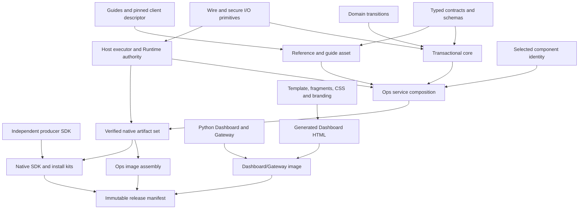

# Target graph, boundaries and cache design

Current implementation: [BUILD.md](../BUILD.md). This document retains the broader target design/backlog.

Status: proposed — names below are target interfaces to implement, not available commands.

## 1. Build architecture

Use existing build engines for compilation/execution. The integration candidate is
Bazel with pinned `rules_rust` and `rules_python`; Cargo remains the manifest/lock
and developer/IDE interface. BuildKit assembles images from accepted components.
The pilot must select exact compatible versions; no version tuple has been tested
or installed as part of this plan.

`crate_universe` can derive dependency targets from Cargo inputs
([official integration](https://bazelbuild.github.io/rules_rust/crate_universe_bzlmod.html)).
It does not remove the need to model local crates, generated inputs, build scripts,
features and native C dependencies. Python has explicit library/binary/test rules
([rules_python](https://rules-python.readthedocs.io/en/latest/)).
Keep Cargo.lock authoritative for third-party Rust resolution; generated Bazel
module/resolution locks are pinned integration outputs, not independently edited
Rust version lists. Check feature/target resolution parity before cutover.

A giant `genrule` that invokes `cargo build --workspace` with the whole repository
as its input is not an acceptable migration. It reproduces today's invalidation.

This graph describes proposed build dependencies, not process authority. Ops
retains the current separated execution/log/index workers and host protocol.
No build target dispatches a research Job.

## 2. Concrete extraction boundaries

| Boundary | Current coupling | Proposed extraction | Invariant |
|---|---|---|---|
| Build identity | core build.rs and env constants throughout service | Small composition-level identity provider; separate component/source and release-envelope records | Status never claims a different artifact/source |
| Contract registry | core contracts, error helpers and lineage enum | `loom-contracts`-style pure schema/DTO/enum module or crate | One schema/enum authority, stable canonical bytes |
| Guides/reference | onboarding embedded in core | Separate compiled/reference asset, supplied at Ops composition | Exact schemas/guides and client pin remain discoverable/offline |
| Host protocol | host imports core error/hash/rows/storage/validation | Minimal protocol and secure I/O boundary; pure Runtime contract functions | Same authentication, path rejection, hashes and resource ownership |
| Transactional core | many `impl Application` files over one connection | Retain one application transaction boundary initially | No split commits, duplicate outbox/effect authority or raw-SQL API |
| Browser generation | monolithic empty-data template patched by generator | One pure generated artifact target with exhaustive declared fragments | Same UI; pinned template; no host catalog in output |
| Python glue | sys.path imports and installed relative paths | Explicit libraries/resources and artifact arguments | Existing script/installer entry points remain compatible |

Do not introduce a generic "common" crate containing all of core. Extract a
primitive only after enumerating consumers and preserving its tests. For example,
Runtime manifest primary selection must be moved once and consumed by both host
and core, not copied into two validators.

A tiny metadata crate still imported by core would invalidate core when metadata
changes. The dependency must point from composition to core, not back from core
to release metadata. Likewise, moving guides to another crate does not help if
core continues to depend on its complete contents.

## 3. Identity contract

Keep these identities separate:

1. **Component source identity:** normalized declared source/resource content and
   dependency locks for a component, excluding incidental timestamps and worktree
   absolute paths.
2. **Action identity:** component inputs plus toolchain/platform/options/dependency
   artifacts and the actual command or build rule implementation.
3. **Artifact identity:** digest of actual output bytes and its platform/ABI.
4. **Release identity:** numbered immutable assembly pointing to exact component
   artifacts, upgrade instructions, client/guide pins and provenance.
5. **Installation identity:** operational machine/account/storage state, never a
   cache key or source artifact.

The current updater expects the running build_id to equal the selected release
and extracts four native binaries from the matching Ops image. Preserve that
contract until an explicit component-aware manifest/status/update revision is
implemented. Initially keep numbered releases and speed up their underlying
compilation; do not relabel an old binary with a new source hash.

Later, a release may reference an unchanged component digest only if its manifest
states the component's actual source/build identity and the containing release
identity separately. Running status, Dashboard footer, guide manifests, offline
kits, `native_artifacts.verify_release`, update health and rollback all consume
that distinction. Old clients retain documented build_id behavior during migration.

Workspace package versions currently change with every release. Decouple internal
crate/protocol versions from the release ordinal only with SDK/producer/version
compatibility tests. A release envelope is not permission to alter frozen
Component/Profile/Runtime source pins.

## 4. Target interface

A target declares its source files, generated dependencies, toolchain, artifacts,
resources and cache/side-effect class. In Bazel these belong in rule attributes,
toolchains, runfiles and execution constraints, not a parallel custom JSON engine.
A generated read-only target inventory can support feature audit and explanation.

Representative proposed targets:

| Target family | Inputs | Outputs / consumers |
|---|---|---|
| `dashboard:workspace` | Pinned template, build.py/lazy_logs, every included JS/CSS, branding/theme | One generated HTML artifact; source check, browser, image |
| `reference:bundle` | Contract registry/schema/route authority, action docs, guide catalog and members, client descriptor | Exact reference JSON/Markdown and guide asset |
| `native:core` | Core/domain/contract/protocol sources and SQL schemas | Core library and tests |
| `native:host` | Host/protocol/Runtime contract sources | Host binary/library and boundary tests |
| `native:ops` | Composition, core/host artifacts, reference and component identity | Service executable and real HTTP/MCP fixtures |
| `native:sdk` | Producer SDK, templates and its declared dependencies | Independent SDK binary/source kit |
| `tests:browser-*` | Generated HTML, relay, fixture source/data, native binaries as needed, pinned browser environment | Per-file/class results/screenshots |
| `tests:compatibility-*` | Explicit retained Python libraries and fixtures | Differential or active Python-boundary receipts |
| `tests:scale` | Native binaries, large deterministic fixture and limits | Scale correctness evidence; separate scheduling class |
| `images:*` | Exact accepted native/web artifacts and locked runtime base | Immutable image digest and artifact manifest |
| `release:assembly` | Component manifests, source/upgrade allowlist and licenses | New immutable release/kit; publication separate |

Discover added/deleted/renamed inputs through directory/file-set declarations and
source-control membership. Do not rely only on the set of files that happened to
exist at the previous successful run. Relevant scripts retain executable modes;
symlink targets and generated-source maps are inputs where significant.

## 5. Cache correctness

Effective action identity includes source/resource content, dependency artifacts,
rule/generator version, argv/configuration, lockfiles, Rust/Python/C/linker versions,
Rust target/features/profile/flags and relevant environment. OCI actions also
include exact base/architecture. Browser actions include Firefox/geckodriver,
fonts/system libraries and fixture/relay versions. Different worktree paths are
normalized only where the tools' path/source behavior has been proven equivalent.

Do not implement this identity scheme independently of the chosen build engine.
Map all real inputs into its action key and validate misses/hits with action logs.

| Action | Reuse policy |
|---|---|
| Hermetic compile/generate/unit/protocol fixture | Cacheable with complete declared inputs |
| Browser in a pinned isolated execution environment | Cacheable after fixture/environment isolation is demonstrated |
| Local browser against uncontrolled desktop libraries | Local selection allowed; result-cache reuse off until environment is modeled |
| Docker-daemon CPU acceptance | Local explicit target; result-cache reuse off by default |
| Live installation, TLS, storage parity, active-Job drain, backup/restore | Never reuse as current acceptance |
| Token issuance, package publication, service activation/update | Explicit side effect; never a cached success stamp |

Freeze the selected input snapshot or verify the input set again before accepting
a result. Concurrent source edits must invalidate/quarantine the affected result;
source identity captured before a long run alone is insufficient.

Only completed accepted outputs enter the shared cache. Interrupted/failed work
must not masquerade as a successful artifact. Concurrent work uses isolated output
roots and atomic publication. Untrusted CI cannot write trusted release evidence;
private operational material is not an action input or uploaded cache artifact.

## 6. Verification selection and evidence

The feature catalog remains the review map. Build dependencies and test target
inputs determine executable invalidation. Public-contract changes additionally
select explicit consumer integration targets; unknown/dynamic dependencies select
a conservative known target set with an explanation.

Report `executed_pass`, `reused_pass`, `failed`, `skipped`, `not_selected` and
`unverified` distinctly, plus the exact scope and prior receipt for reuse.
A previously passing test of a **different binary** cannot be reclassified as a
current pass because a feature owner appears unchanged. A monolithic core test
binary still invalidates together; finer reuse requires real target boundaries.

Python class/module fixtures and shared browser sessions make file/class targets
the initial isolation unit. Avoid per-method caching until setup/teardown and
shared mutable state are removed. Rust tests retain process isolation; optional
[nextest filtering](https://nexte.st/docs/filtersets/) is a runner optimization,
not proof that tests have no missing dependencies.

Full release verification remains once per final candidate in the initial phases.
Use affected checks while editing; do not repeat a full pass when neither source,
toolchain nor required acceptance scope changed. Later cached hermetic targets can
contribute to a complete candidate audit only under their exact valid action keys.
External acceptance still runs against the actual final artifact/target.

## 7. Packaging, deployment and platform ABI

Never copy a locally built Ubuntu/debug executable into a Debian runtime image
just because both say Linux/x86_64. Pin compiler/C/sysroot/linker/stdlib/base ABI;
the representative pilot must build SQLite/ring/proc-macro dependencies and run
Ops in the intended runtime image. Byte-equal Cargo/Bazel output is not assumed;
compare resolved inputs/contracts and test the actual selected release artifacts.

Introduce component-aware transfer only after identity compatibility. Reuse
already-present content-qualified images/layers and kits; checksum actual bytes.
For UI-only updates, a future planner may restart only Dashboard/Gateway when
native code, shared host files, auth/network policy and migrations are unchanged.
That is an updater contract change with separate failure/rollback tests, not a
build cache optimization. Until then, keep existing deployment preservation.

## 8. Repository boundaries

Do not merge the repositories. Loom exports pinned native/reference artifacts;
Loom-Use consumes an exact selected server/client pair in compatibility CI. Pale
keeps its engine fingerprint separate from package/adapter identity and preserves
platform-wheel receipts. Shared build conventions may be versioned/copied as
small tooling rules; no cross-repository reference may mean "whatever is latest".

## 9. Public-contract and authoring impact

P1 targets tooling behavior, P2 preserves runtime semantics while changing module
boundaries, and P5 explicitly revises release/status/update identity. Review
API/MCP schema and guide delivery, Dashboard consumers, Pale observation, client
refresh, installer health and rollback together for that last contract change.
No operational database schema migration is needed merely to adopt a build tool.

Platform developers may use Bazel after the pilot; researchers and agents creating
Components, Tools or Jobs keep the documented Rust SDK/Cargo authoring flow.
A platform build dependency must not become a new prerequisite for installing
Loom-Use, using a prebuilt offline kit or running an accepted Job. Production
operators need the selected artifacts and existing installer requirements, not an
automatically installed Bazel server or a compiler.
