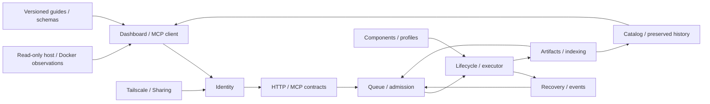

# Feature boundaries and change impact

This is the developer and agent entry point for deciding **what to change and what to verify**. It adds no review gates to running Jobs or user research workflows.

## Authoritative sources and workflow

1. Find the feature ID and owned files in `catalog.json`. Each file has one owning feature.
2. Read that feature's contracts, invariants and `depends_on` relationships.
3. Review direct consumers after changes; this does not mean every related file must change.
4. Extend behavior/failure-boundary tests and run relevant suites.
5. For public-contract changes, review API/MCP, UI, guides and installation/deployment boundaries.

```bash
python3 deploy/features.py check
python3 deploy/features.py impact dashboard/sso.py
python3 deploy/features.py impact ops/job_contract.py --transitive
bash deploy/test.sh --browser
```

`check` detects missing references, duplicate ownership, invalid feature relationships and unregistered new source/tests. Tests also validate JSON Schema. `impact` includes direct consumers by default; `--transitive` includes indirect consumers. The list defines review scope, not mandatory edits.

## Relationships



Authoritative execution states and hook stages are implemented by worker/finish in `ops/ops.py`, `ops/execution.py` and `ops/recovery.py`. Do not duplicate their state tables here.

## Feature blocks

| Feature | Responsibility | Main consumers |
|---|---|---|
| [identity](identity.md) | Authentication, SSO, ownership | API, Dashboard, networking, data |
| [api](api.md) | HTTP/MCP and Job input contracts | Dashboard, clients |
| [queue](queue.md) | Ordering, admission, preparation | Execution, recovery, catalog |
| [execution](execution.md) | Lifecycle, hooks, executor | Queue, recovery, results |
| [recovery](recovery.md) | Recovery leases, retries, events | Queue, external callers |
| [results](results.md) | Artifacts, indexing, lineage | Dependent Jobs, catalog |
| [extensions](extensions.md) | Components, profiles | Execution, results |
| [catalog](catalog.md) | Queries, original preservation, files | Dashboard, API |
| [diagnostics](diagnostics.md) | Private local error collection | API, Dashboard, installation |
| [observations](observations.md) | Resource and Docker observations | Dashboard |
| [dashboard](dashboard.md) | Browser and relay | External users |
| [onboarding](onboarding.md) | Usage tools, guides, versions | External agents |
| [ssh](ssh.md) | Personal host accounts and local/remote connection discovery | Dashboard, Loom Use |
| [network](network.md) | Tailscale, Serve, Sharing | Installation, identity |
| [portability](portability.md) | Migration, remote fencing | Records, execution |
| [installation](installation.md) | Compose, installation, updates | All service startup |
| [testing](testing.md) | Tests and specification checks | Development only |

`ops/ops.py` still contains HTTP/MCP entry points and worker orchestration across several features. API owns the file, while queue/execution/recovery/results relationships are explicit. Future extraction can proceed by feature while retaining the same contract tests. Logical feature blocks do not correspond one-to-one to containers.

## Adding features

Add a unique ID, purpose, sources, tests, contracts, depends_on, spec, invariants, change_rule and live_validation to `catalog.json`. Extend an existing entry for existing features. `catalog.schema.json` defines fields; the schema version is `loom-features/v1`.

- Link to executable code/JSON Schema rather than duplicating state or field enums.
- For API fields, review `ops/job_contract.py`, `ops/mcp_groups.py` and documentation examples together.
- For new files/libraries, check Dockerfiles, snapshots and installer HOST_FILES.
- Edit workspace source and rebuild generated HTML; never edit the output directly.
- Put usage contracts in `loom_use`, development design in `docs`, installation procedures in `deploy`.
- Describe policy-change rationale, observable before/after behavior, compatibility, data transformation and tests in the PR. Small changes need no separate ADR or approval gate.

## Extending tests

Map all feature tests in the catalog. Use real SQLite, filesystems and signature verification; mock external boundaries such as Docker/Tailscale. Cover relevant expiry, rejection, duplication, restart, concurrency and external failures as well as success.

Use common fixtures in `tests/ops/test_support.py` and `tests/dashboard/mock_ops.py`. Mock public boundaries without duplicating implementation calculations in assertions. Compare HTTP/API/MCP through shared scenarios where possible and verify UI changes with Firefox.

Record JSON/JUnit results. Keep unverified areas such as actual Tailscale approval, GPU behavior and long-running execution in each feature's `live_validation`. Test counts alone do not prove operational readiness.

## Installation and cross-feature verification

Read [VERIFICATION.md](VERIFICATION.md) for the reviewed boundary of every block.
The installation doctor is a consumer of identity, network, execution, storage,
observations and onboarding contracts. Keep it current when those contracts
change; tests of a configured development instance do not prove a fresh install.

After running suites, use `python3 deploy/features.py audit --evidence <report-directory>`
to match every block to actual cases and the tested source hashes. Missing, skipped,
failed or stale checks are not passes. This does not turn mocked boundaries into
external Tailscale/SSH acceptance.
