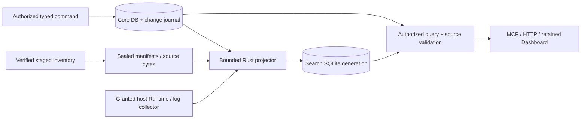

# Authority and Rust service design

Status: proposed; see [README](README.md). The six existing crates remain the
process/trust boundaries. A generic untyped object store does not replace Jobs,
results, software registries or their typed application policies.

## Data ownership

| Store | Authoritative contents | Rebuild / failure behavior |
|---|---|---|
| Core SQLite | Domain records; common Item/alias/revision registry; inventory descriptors; stream registrations; verified copy/withdrawal receipts; catalog change journal | Back up and preserve; a search index cannot replace missing authority |
| Sealed inventory manifests | Stable file Item IDs, exact parent revision/entry keys, role, content evidence and origin; chunk hashes/counts | Authoritative metadata, copied and verified with the parent; never regenerated with new IDs during rebuild |
| Log source and sealed stream manifests | Original bytes, stream generation/segments, offsets, gaps, closed-prefix hashes and retention receipts | Raw bytes follow explicit retention; searchable text is not a substitute for lost source |
| Search SQLite | Item/file/edge/log-document projections, FTS, observed availability, checkpoints, scan continuation and rebuild generations | Disposable projection; recreate from retained authority without changing IDs or Jobs |
| Existing host Runtime SQLite | Runtime revisions, grants, validation and installation receipts | Remains host-owned; native catalog imports exact snapshots through its protected adapter |

Paths are installation-selected. The search DB defaults under the instance's local
persistent state on a local filesystem; optional placement is explicit in the plan.
Inventory/source locators use configured storage identities. No fixed dependency,
research, remote-host or personal workspace directory is introduced.

The core registry has rows for domain Items and log streams, not every file entry
or log segment. File Item resolution uses the index normally, or a bounded inventory
page when its exact inventory descriptor is known. A cold ID-only request with a
missing index returns `index_unavailable`; it never scans all manifests at request time.
Source-only rebuild rehydrates those file mappings from stable manifest entries.

## Proposed internal modules

| Boundary | Planned module | Rule |
|---|---|---|
| Typed identity | `domain::item` | ItemId/RevisionId/FileId/StreamId/LocatorId are distinct types |
| Authority adapter | `core::items` | Resolve exact native refs, enforce alias uniqueness and typed capabilities |
| Inventory | `core::inventory` | Sealed descriptors and publication/replay checks; byte work outside writer |
| Query protocol | `core::search` | Typed filters, source access, consistent envelope and source validation |
| Search engine | `ops::indexer` plus internal `core::index_store` | Single index writer, bounded read snapshots; no scheduler transitions |
| Log collection | `host::logs`, `ops::log_indexer` | Per-stream cursors; no long Docker/log I/O under Executor authority mutex |
| Reconcile | `core::catalog_reconcile` | Bounded inspect/propose/apply with evidence and receipts |
| Migration | Existing migrator + explicit catalog backfill | Resumable additive identities; no rewriting accepted manifests |

Names are planned modules, not existing imports or extra public daemons. Extract an
independent crate only if dependency enforcement justifies it; do not add plumbing
merely to increase the crate count. The producer SDK never opens these databases.

## Authoritative transaction and asynchronous projection

1. Outside the core writer, validate files/source evidence and stage sealed inventory
   chunks with assigned Item IDs. Candidate identity is retained in a durable keyed
   intent so replay after a lost response reuses it. Fsync candidate bytes.
2. In one existing typed command transaction, recheck actor, epoch, parent revision,
   Attempt/cancellation fences and candidate file stamps. Commit the domain change,
   Item/descriptor metadata and a new catalog change event atomically.
3. The index worker reads journal sequence ranges and referenced manifests after
   commit. Apply projection documents and its checkpoint in **one search-DB transaction**.
4. Lost index acknowledgement replays the same event/doc keys. It cannot create a
   second Item, Attempt, scientific output or completion notification.

No dual-write acceptance is assumed across WAL databases. SQLite documents that
transactions spanning attached WAL databases are not atomic as a set; the separate
journal/checkpoint protocol is deliberate. [SQLite WAL](https://www.sqlite.org/wal.html).

Do not reuse recipient delivery `events` as this journal: search projection must
neither ACK agent events nor create another external completion report. Proposed
journal fields: `(installation_origin, seq, event_id, entity_key, source_version,
operation, descriptor_ref, committed_at, required_index_schema)`. Event IDs remain
stable across transfer; local sequence numbers are not global Item IDs.

## Stable paging during incremental writes

A generation ID and high watermark alone do not freeze in-place updated search
rows. Store versioned projection documents with `valid_from_seq`/`valid_to_seq`
and immutable indexed payloads. A search pins the index committed checkpoint S;
all its pages filter versions valid at S. Keep historical projection versions for
the maximum cursor TTL, with bounded storage and explicit expiry on pressure.
The core head may be ahead of S and is reported separately. This is index MVCC,
not a second scientific revision or a new core state machine.

FTS supplies candidate matching. Initial rank is a deterministic field-match tier
and per-document score based only on the query and that immutable document version,
then recorded time/ID. Do not use changing global FTS corpus statistics to reorder
pages under the same cursor. An optional future BM25 rank needs a frozen result
snapshot or equivalent stable scoring contract, not merely an appended ID sort.

Current authorization, purge/tombstone and privacy changes override the snapshot.
Invalidate the affected cursor/access epoch rather than silently skipping a hidden
hit or returning its old snippet. Content retention can delete all indexed versions
immediately and invalidate cursors; cursor TTL cannot extend source privacy policy.
Ordinary label/current-revision changes after S appear on a new query; returned
records identify their exact as-of version and do not claim to be the latest now.

## Rebuild and concurrency

Create generation G+1 separately. Capture a core read-snapshot high watermark S;
project its descriptors and referenced host snapshots, then replay events after S.
Pin source manifests for the build; purge cannot remove pinned descriptors. Validate
row/document counts, source versions and integrity before publishing a small durable
active-generation pointer. Requests pin one generation; retire G only after leases
expire. Index writes never hold a core transaction while hashing/reading manifests.

A source epoch/ACL/tombstone version different from a cached hit is revalidated
before its title, snippet or relation is returned. `catalog_head`, `indexed_through`,
`observed_at` and `partial` describe lag. Search readiness is not Job readiness.

Use bounded workers, queues and bytes-in-flight; reserve execution control capacity.
Disk-full index failures pause projection, not cancellation or ownership return.
The journal remains durable. If authoritative metadata itself cannot commit, return
an explicit keyed failure under existing command semantics; do not claim acceptance.
Journal compaction requires a verified reconstruction checkpoint and retention plan,
not just the current worker's cursor. [FILES](FILES.md), [LOGS](LOGS.md) and
[MIGRATION](MIGRATION.md) specify evidence and lifecycle details.
